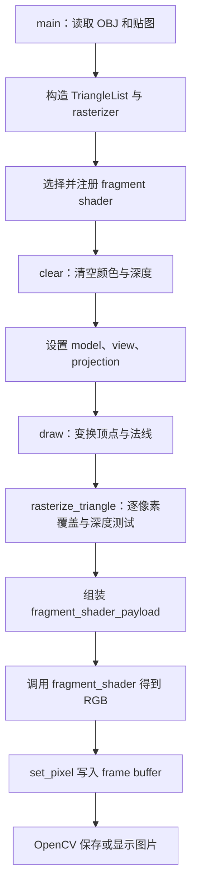

# Assignment 3：已提供函数的作用与使用方法

本文讲解 `Assignment3_code/` 的框架接口及当前数据流。基础算法已实现；本文保留接口示例和原框架注意点，完成状态以 [README](README.md) 为准，改进建议见 [RASTERIZATION_REVIEW](RASTERIZATION_REVIEW.md)。

## 1. 从 main 看一帧图像如何产生



图中 G → J 是本作业扩展的逐片元流程，当前已接通：覆盖和深度测试后，插值属性、调用 shader，再写入帧缓冲。

当前 `main()` 还会注册 `vertex_shader`，不过 `draw()` 实际没有调用它。不要把头文件里的流水线注释理解为每个阶段都已实现：这里也没有完整的裁剪阶段。

| 文件 | 阅读时重点关注什么 |
| --- | --- |
| `main.cpp` | 程序入口、矩阵生成、shader 选择、图像输出 |
| `Triangle.hpp/.cpp` | 一个三角形携带哪些顶点属性 |
| `rasterizer.hpp/.cpp` | 管线状态、变换、缓冲区、插值辅助函数 |
| `Shader.hpp` | 光栅化器和着色函数之间如何传递数据 |
| `Texture.hpp` | 图像加载和 UV 查询；`Texture.cpp` 目前只有注释 |
| `OBJ_Loader.h` | 已提供的模型读取工具；先会调用公开入口即可 |
| `global.hpp` | `MY_PI`、`TWO_PI` 和 `u08` 类型别名，没有渲染函数 |

## 2. main.cpp：组织渲染过程

### 2.1 get_view_matrix(eye_pos)：将相机移动到原点

输入是相机在世界空间中的位置 `Eigen::Vector3f`，返回一个 4×4 矩阵。

```cpp
Eigen::Matrix4f view = get_view_matrix(Eigen::Vector3f(0, 0, 10));
```

内部建立平移 `(-eye_pos.x(), -eye_pos.y(), -eye_pos.z())`。相机在 `(0,0,10)` 时，世界原点会变为观察空间中的 `(0,0,-10)`。

这是固定观察方向的简化相机，只处理位置，没有根据目标点旋转相机。修改 `eye_pos` 不会自动让相机始终朝向模型。

### 2.2 get_model_matrix(angle)：缩放并旋转模型

输入 `angle` 的单位是角度，函数先转成弧度，然后建立绕 y 轴旋转矩阵，并将模型统一放大 2.5 倍。平移矩阵当前是单位矩阵。

返回值是 `translate * rotation * scale`。对列向量作用时，顺序从右向左：先缩放，再旋转，再平移。

```cpp
r.set_model(get_model_matrix(140.0f));
```

角度为 0 也仍会缩放 2.5 倍，并非完全不变换。模型变换控制物体，相机变换控制观察空间，二者不要混淆。

### 2.3 vertex_shader(payload)：原样返回顶点位置

```cpp
Eigen::Vector3f vertex_shader(const vertex_shader_payload& payload);
```

当前实现只有 `return payload.position`。它不会自己执行 MVP，也不修改顶点。

`r.set_vertex_shader(vertex_shader)` 的含义是保存这个回调。当前 `draw(TriangleList)` 没有调用保存的回调，因此修改这个函数不会自动影响模型变换；本框架的实际变换代码在 `draw()` 内。

### 2.4 normal_fragment_shader(payload)：用颜色显示法线方向

输入片元数据，使用其中的 `normal`；输出范围约为 `[0,255]` 的 RGB 浮点向量。

它先归一化法线，然后执行：

```text
color = (normal + (1,1,1)) / 2 * 255
```

单位法线的每个分量在 `[-1,1]`，先映射到 `[0,1]`，再映射到 `[0,255]`。例如法线 `(0,0,1)` 对应 `(127.5,127.5,255)`。

这不是光照计算：它不依赖灯光、纹理或材质。它适合检查法线变换、法线插值和模型方向是否正常。

```cpp
r.set_fragment_shader(normal_fragment_shader);
```

法线必须是有效的非零向量。法线本身错误时，颜色看起来平滑也不能说明整个管线正确。

### 2.5 reflect(vec, axis)：计算关于法线轴的反射方向

返回 `normalize(2 * dot(vec, axis) * axis - vec)`，其中 `axis` 应为单位法线。

本式适用于把 `vec` 理解为“从表面指向光源”的方向；若你使用的是“光线射向表面”的入射方向，符号约定不同，不能直接混用。

例如 `vec=(0,0,1)`、`axis=(0,0,1)` 时返回 `(0,0,1)`。它是文件内的 `static` 辅助函数，当前已提供逻辑没有使用它。Blinn–Phong 使用半程向量，本作业无需为了用上 `reflect()` 而改变光照模型。

### 2.6 main(argc, argv)：加载、选择模式、输出

主要步骤是：

1. 调用 `Loader.LoadFile()`，读取奶牛模型。
2. 遍历网格顶点，每 3 个构造一个 `Triangle`，保存位置、法线和 UV。
3. 创建 `rasterizer(700,700)`，加载默认高度图 `hmap.jpg`。
4. 根据命令行选择 shader；`texture` 模式改用 `spot_texture.png`。
5. 清空缓冲、设置矩阵、绘制、保存或显示。

从 `Assignment3_code/build-ucrt` 运行：

```powershell
./Rasterizer.exe --check-environment
# 构建成功后可选择以下模式
./Rasterizer.exe normal.png normal
./Rasterizer.exe phong.png phong
./Rasterizer.exe texture.png texture
./Rasterizer.exe bump.png bump
./Rasterizer.exe displacement.png displacement
```

`argv[0]` 是程序名，`argv[1]` 是输出图片，`argv[2]` 是 shader 名。无参数时进入交互窗口，默认 `phong`，按 a/d 调整角度、Esc 退出；交互循环也会持续覆盖 `output.png`。只传图片名时保存一帧，默认也是 `phong`。未知 shader 名没有明确报错，会保持默认选择，因此注意拼写。

`--check-environment` 是环境检查分支，读取模型和两张贴图后就退出，不调用投影或光栅化。它只能证明资源及运行依赖可用。

## 3. Triangle：保存三角形的三个顶点属性

### 3.1 数据的含义

| 成员 | 类型 | 含义 |
| --- | --- | --- |
| `v[3]` | `Vector4f` | 三个齐次顶点位置 |
| `color[3]` | `Vector3f` | 三个顶点的 RGB，setColor 后为 `[0,1]` |
| `normal[3]` | `Vector3f` | 三个顶点法线，不保证已经归一化 |
| `tex_coords[3]` | `Vector2f` | 三个顶点的 UV |
| `tex` | `Texture*` | 当前主流程未使用；实际纹理由 rasterizer 管理 |

注意同一个 `Triangle` 类型会存储不同阶段的位置。加载时是模型空间；传给 `rasterize_triangle()` 的副本中，x/y 已经是屏幕坐标。类型名称本身不能告诉你坐标空间。

### 3.2 构造函数与设置函数

`Triangle()` 把顶点设为 `(0,0,0,1)`，颜色和 UV 清零；没有显式初始化法线，使用前必须设置。

```cpp
Triangle t;
t.setVertex(0, Eigen::Vector4f(1, 2, 3, 1));
t.setNormal(0, Eigen::Vector3f(0, 0, 1));
t.setTexCoord(0, Eigen::Vector2f(0.25f, 0.5f));
t.setColor(0, 255, 128, 0);
```

索引 `ind` 只能是 0、1、2，这些函数不检查索引范围。以上只设置第一个顶点，完整三角形还需设置另外两个。

| 函数 | 实际行为 |
| --- | --- |
| `setVertex(ind, ver)` | 直接赋值，不自动变换 |
| `setNormal(ind, n)` | 直接赋值，不自动归一化 |
| `setTexCoord(ind, uv)` | 直接赋值，不限制 UV 范围 |
| `setColor(ind,r,g,b)` | 检查输入 `[0,255]` 后除以 255；非法范围会终止程序 |
| `setNormals(array)` | 一次设置三个法线 |
| `setColors(array)` | 调用三次 setColor，因此输入仍应是 `[0,255]` |
| `a()/b()/c()` | 按值返回 v[0]/v[1]/v[2]，不会修改原顶点 |

不要把已经归一化的颜色再交给 `setColors()`，否则会再次除以 255 而变暗。

### 3.3 toVector4()：返回副本，但会把 w 重设为 1

它返回 `std::array<Vector4f,3>`，每个元素是原顶点的 `(x,y,z,1)`。当前顶点已经是四维，所以此函数不是原样复制。

本作业的 `draw()` 保留了投影后的 w 供后续使用。如果在光栅化中调用 `t.toVector4()`，会丢掉这些 w。需要原始 w 时，应读取 `t.v`，不能根据函数名猜测行为。

## 4. rasterizer：状态、变换与像素缓冲

### 4.1 rasterizer(w,h)：准备存储空间

```cpp
rst::rasterizer r(700, 700);
```

构造函数保存宽高，为颜色与深度数组分别分配 `w*h` 个元素，将纹理设为 `std::nullopt`。它不等于完成每帧初始化：矩阵需用 setter 设置，深度需用 `clear()` 设为正无穷，fragment shader 也需注册。

### 4.2 set_model / set_view / set_projection：保存矩阵

这三个函数只做赋值，真正使用矩阵是在 `draw()`。

```cpp
r.set_model(get_model_matrix(140.0f));
r.set_view(get_view_matrix(Eigen::Vector3f(0, 0, 10)));
r.set_projection(get_projection_matrix(45.0f, 1.0f, 0.1f, 50.0f));
```

不要认为调用 setter 就已经绘制了模型。矩阵状态会一直保留，直到下一次设置。

### 4.3 clear(buff)：每帧重置颜色和深度

```cpp
r.clear(rst::Buffers::Color | rst::Buffers::Depth);
```

颜色数组填黑色 `(0,0,0)`；深度数组填正无穷，以便第一次有效深度可以通过比较。

`Buffers` 的数值是位标志，重载的 `operator|` 合并选择，`operator&` 检查是否包含某项。只传 `Color` 就不会清空深度。旋转模型时保留旧深度会影响新一帧的可见性。

### 4.4 set_texture(tex)：让 shader 可以查询纹理

```cpp
r.set_texture(Texture("../models/spot/spot_texture.png"));
```

它把纹理对象保存到 `std::optional<Texture>` 中。`optional` 表达“可能没有纹理”：有值时 `&*texture` 获得内部对象地址，没有值时应传 `nullptr`。

`Triangle::tex` 与它不是同一个成员；主流程通过 rasterizer 的纹理构造片元 payload。

### 4.5 set_fragment_shader / set_vertex_shader：保存回调

`std::function<Vector3f(fragment_shader_payload)>` 可理解为“接收一份片元数据，返回三维颜色的可调用对象”。

```cpp
r.set_fragment_shader(normal_fragment_shader);
```

这句不会立即计算颜色。光栅化循环中调用 `fragment_shader(payload)` 时，才执行之前保存的函数。注册一次，就可以让许多像素复用同一个着色规则。顶点回调也只是被保存；当前 draw 不调用它。

### 4.6 draw(TriangleList)：已完成管线中最重要的函数

```cpp
r.draw(TriangleList);
```

它逐个处理三角形，具体完成以下操作。

1. **复制三角形。** `Triangle newtri = *t` 创建副本，避免每帧把变换重复累计到原模型上。
2. **保留观察空间位置。** 计算 `view * model * position`，取前三个分量存入 `viewspace_pos`。这是后续光照的位置来源。
3. **计算投影位置。** 使用 `projection * view * model` 变换顶点，得到裁剪空间齐次坐标。
4. **齐次除法。** x、y、z 分别除以 w；代码没有修改 w 本身。保留下来的严格说是裁剪空间 w，其与观察空间 z 的符号关系由投影矩阵决定。
5. **变换法线。** 使用 `(view*model).inverse().transpose()`，并以 w=0 扩展法线；取前三个分量作为观察空间法线。逆转置保持法线与变换后表面的垂直关系。
6. **视口变换。** x/y 从 `[-1,1]` 映射到 `[0,width]` 和 `[0,height]`；z 用 f1/f2 做线性映射。
7. **写入副本属性。** 设置变换后的位置和法线，并把三个顶点颜色统一设成 `(148,121,92)`（setColor 内部会归一化）。
8. **进入逐像素处理。** 调用 `rasterize_triangle(newtri, viewspace_pos)`。

因此光栅化器收到的数据是：

| 数据 | 此时的空间或范围 |
| --- | --- |
| `t.v[i].x()/y()` | 屏幕坐标 |
| `t.v[i].z()` | 经过除法及视口深度映射的值 |
| `t.v[i].w()` | 保留的裁剪空间 w |
| `view_pos[i]` | 观察空间位置 |
| `t.normal[i]` | 观察空间法线，尚需注意归一化 |
| `t.color[i]` | 归一化顶点颜色 |
| `t.tex_coords[i]` | 原模型 UV |

头文件将第二个参数命名为 `world_pos`，但实现和调用实际传的是观察空间位置，阅读时以数据来源为准。

此函数把近远平面常数写成 0.1 和 50，修改投影参数时要检查两处是否一致。它也没有完整裁剪和屏幕越界处理，不能假设传入光栅化的坐标一定落在有效像素范围。每帧固定设置棕色还意味着自行给模型顶点设置的颜色会在此被覆盖。

### 4.7 to_vec4(v3,w)：扩展三维向量

```cpp
auto point4 = to_vec4(Eigen::Vector3f(1,2,3));        // (1,2,3,1)
auto normal4 = to_vec4(Eigen::Vector3f(0,0,1), 0);  // (0,0,1,0)
```

默认 w=1，适合位置；w=0 表达方向。它只补上一个分量，不会归一化，也不做投影。它是 rasterizer.cpp 中的辅助函数，不是 rasterizer 的公开成员。

### 4.8 insideTriangle(x,y,vertices)：覆盖测试

输入屏幕上的点和三个顶点的地址，返回是否严格位于三角形内部。它只使用顶点 x/y。

代码将二维点扩成 `(x,y,1)`；两顶点的叉积得到边所在直线的系数。点与该系数向量点乘可以判断位于直线哪一侧。它比较采样点和对面顶点的符号，三个边都同侧则在内部。

在 rasterizer.cpp 内可以像这样调用：

```cpp
bool covered = insideTriangle(x, y, t.v);
```

这个旧辅助函数参数为 `int`，会截断 `x+0.5f`，且严格 `>0` 会排除边界点。当前 rasterize_triangle 已不调用它，改用像素中心的重心坐标进行覆盖判断。

### 4.9 computeBarycentric2D(x,y,v)：获得三个插值权重

输入二维采样点和三个顶点，返回 `std::tuple<float,float,float>`。

```cpp
auto [alpha, beta, gamma] = computeBarycentric2D(x, y, t.v);
```

这是 C++17 的结构化绑定。对非退化三角形，三个权重之和约为 1，满足 `P = alpha*A + beta*B + gamma*C`。

例如 A=(0,0)、B=(2,0)、C=(0,2)，P=(0.5,0.5) 的权重为 `(0.5,0.25,0.25)`。

函数本身不检查是否在三角形内部，也不处理面积为零导致的分母为零。它得到的是屏幕二维重心权重，不会自动完成属性的透视校正。

### 4.10 interpolate(...)：加权组合属性

两个重载分别处理 Vector3f 和 Vector2f，形式都是：

```text
result = (alpha * a + beta * b + gamma * c) / weight
```

Vector3f 可用于颜色、法线或着色位置；Vector2f 可用于 UV。示例仅展示普通线性插值：

```cpp
auto uv = interpolate(0.5f, 0.25f, 0.25f,
                      Eigen::Vector2f(0,0), Eigen::Vector2f(1,0),
                      Eigen::Vector2f(0,1), 1.0f);
// uv = (0.25, 0.25)
```

`weight` 是一个数值除数，不是开关。该函数不会自己读取顶点 w，也不会自动选择坐标空间；透视校正所需的权重和分母由调用方组织。法线插值后还需归一化，分母不能为零。

这三个 `static` 函数定义在 rasterizer.cpp 内部，直接用于同文件的光栅化实现；它们并不是可以在 main 中通过 `r.interpolate()` 调用的公开 API。

### 4.11 get_index / set_pixel：二维位置对应到一维数组

`get_index(x,y)` 返回索引；`set_pixel(point,color)` 计算索引后写入颜色。

```cpp
// 传入合法的整数像素编号
r.set_pixel(Eigen::Vector2i(100,100), Eigen::Vector3f(255,0,0));
```

颜色这里是 `[0,255]` 尺度，函数不会像 Triangle::setColor 那样除以 255。它也不做深度测试、混合或范围检查；深度判断必须在调用前完成。

当前两处均已使用 `(height-1-y)*width+x`，与从 0 开始的像素编号一致。调用前仍应保证 x∈[0,width-1]、y∈[0,height-1]。原框架 `(height-y)*width+x` 的偏移问题已经修正。

### 4.12 frame_buffer()：取得颜色数组本身

返回类型是 `std::vector<Vector3f>&`，所以返回的是引用，没有复制整张图。

```cpp
auto& pixels = r.frame_buffer();
```

若写成 `auto pixels = ...`，则会复制 vector。主程序通过 `.data()` 获得连续数据指针给 OpenCV 使用；不要在 OpenCV 借用指针期间重新分配颜色 vector。

### 4.13 load_* / get_next_id：保留的缓冲区接口

| 函数 | 行为 |
| --- | --- |
| `get_next_id()` | 返回当前编号，再自增；私有辅助函数 |
| `load_positions(positions)` | 将位置数组复制进 pos_buf，返回 pos_buf_id |
| `load_indices(indices)` | 将三角形索引数组复制进 ind_buf，返回 ind_buf_id |
| `load_colors(colors)` | 将颜色数组原样复制进 col_buf，返回 col_buf_id |
| `load_normals(normals)` | 将法线复制进 nor_buf，更新 normal_id；返回类型沿用 col_buf_id |

这些接口保留了前面作业“上传数组，拿编号绘制”的设计，不会真的向 GPU 上传数据，也不会自动归一化输入。

作业 3 的 `main()` 使用 `TriangleList`，不经过这套接口。头文件中的 `draw(pos_buf_id,...,Primitive)` 只有声明，当前 rasterizer.cpp 没有对应定义；直接调用会导致链接错误。使用已经实现的 `draw(TriangleList)`。

### 4.14 draw_line(begin,end)：保留的画线工具

它用 Bresenham 风格的整数误差递推，从起点到终点逐像素画白线，内部调用 `set_pixel()`。z 不参与计算，也没有深度测试。

这是私有函数，不能从 main 中直接 `r.draw_line(...)`。当前三角形填充流程不使用它，先了解用途即可；其边界行为也受 set_pixel 的索引约定影响。

## 5. Shader.hpp：payload 是一份片元的输入数据

`fragment_shader_payload` 不是 shader 本身，而是送给 shader 的数据包。

| 字段 | shader 用它做什么 |
| --- | --- |
| `view_pos` | 着色位置，用来构造光照方向及距离 |
| `color` | 表面颜色，可以作为漫反射系数 |
| `normal` | 表面方向，参与光照或法线显示 |
| `tex_coords` | 纹理查询位置 |
| `texture` | 可用纹理的指针；无纹理时为 nullptr |

带参数构造函数设置 color、normal、tex_coords、texture，但**不设置 view_pos**。使用方式如下，其中属性值需由你在光栅化时计算：

```cpp
fragment_shader_payload payload(color, normal, uv, texture_pointer);
payload.view_pos = shading_position;
Eigen::Vector3f rgb = normal_fragment_shader(payload);
```

默认构造函数只把 texture 设为 nullptr，其余 Eigen 向量没有被显式赋值，不能创建后就直接用于光照。payload 的纹理指针不负责释放对象；着色时原纹理必须仍存在。

`vertex_shader_payload` 更简单，只有 `position` 字段。`light` 定义在 main.cpp，只有 `position` 和 RGB `intensity`，也是数据结构，没有自动执行光照计算的成员函数。

## 6. Texture：图像文件变为可查询的纹理

### 6.1 Texture(name)：读取图片

```cpp
Texture tex("../models/spot/spot_texture.png");
```

通过 `cv::imread()` 加载图像，保存 width/height，并交换红蓝通道，使内部查询结果按 RGB 使用。OpenCV 默认读取 BGR；代码虽然写的是 `COLOR_RGB2BGR`，这里执行的也是同样的红蓝交换。

新增的空图检查在读取失败时抛出异常。路径相对于进程工作目录，不是相对于 Texture.hpp 或 exe 的文件位置。

### 6.2 getColor(u,v)：查询一个纹素

```cpp
Eigen::Vector3f rgb = tex.getColor(0.5f, 0.5f);
```

内部把 UV 转成图像列行：`column=u*width`，`row=(1-v)*height`，然后通过 `image_data.at<cv::Vec3b>(row,column)` 取颜色。行在前、列在后。v 翻转是为了对应图像向下的行编号。

当前浮点坐标传给整数行列参数时会截断，属于单个纹素的离散查询，没有双线性插值。返回 RGB 的尺度是 `[0,255]`，不是 `[0,1]`；用于材质系数时要注意尺度转换。

该函数没有 clamp 或 wrap：u=1、v=0，以及高度差分时偏移后的 UV 都可能越界。双线性方法尚未实现，后续加分项会扩展这里。

## 7. OBJ_Loader 与 OpenCV：会用公开入口即可

### 7.1 Loader.LoadFile(path)

```cpp
objl::Loader loader;
bool ok = loader.LoadFile("../models/spot/spot_triangulated_good.obj");
```

它解析 OBJ 并将数据放入 `LoadedMeshes` 等成员。当前 main 检查返回值和网格是否为空，再读取网格顶点的 `Position`、`Normal`、`TextureCoordinate`。

当前主程序按每三个 Vertices 组成一个三角形使用提供的三角化模型。替换其他模型时，应检查三角化、顶点布局、法线和 UV 是否符合该读取方式；不要只看后缀是 .obj 就认为一定兼容。

OBJ_Loader.h 内部还有向量运算、字符串拆分、材质加载与三角化等实现。本作业主要需要理解 LoadFile 的输入、返回值和读取后的数据，不必重写这些内部工具。

### 7.2 OpenCV 输出链

```cpp
cv::Mat image(700, 700, CV_32FC3, r.frame_buffer().data());
image.convertTo(image, CV_8UC3, 1.0f);
cv::cvtColor(image, image, cv::COLOR_RGB2BGR);
cv::imwrite(filename, image);
```

| 调用 | 作用 |
| --- | --- |
| `cv::Mat(...,CV_32FC3,data)` | 用帧缓冲数据建立三通道 float 图像视图，起初借用现有内存 |
| `convertTo(...,CV_8UC3,1.0f)` | 转成三通道 8 位图像；缩放系数为 1，不会自动把 `[0,1]` 放大到 `[0,255]` |
| `cvtColor(...,COLOR_RGB2BGR)` | 把渲染器 RGB 转成 OpenCV 使用的 BGR 顺序 |
| `imwrite(filename,image)` | 保存图片，格式由扩展名决定 |
| `imshow("image",image)` | 在窗口显示图片 |
| `waitKey(10)` | 处理窗口事件、等待按键；返回键值，当前循环用 27 表示 Esc |

这解释了为什么 shader 返回的是 `[0,255]` 尺度：最后输出阶段并没有再乘 255。颜色超出 8 位范围时转换会饱和，不能依赖这种截断来掩盖光照计算错误。

## 8. 建议的阅读与调试顺序

1. `main()`：找出模型加载、shader 注册和 draw 调用。
2. `Triangle` 与 `fragment_shader_payload`：认清输入输出数据及颜色尺度。
3. `draw()`：逐步跟踪一个顶点，确认每一步处于哪个空间。
4. `insideTriangle`、`computeBarycentric2D`、`interpolate`：了解它们已经做了什么、没做什么。
5. `normal_fragment_shader()` 与输出链：理解一个片元最后如何变成像素。

可在 main 中加断点检查模型读取，或使用 normal 模式在 draw、rasterize_triangle 和 shader 内检查坐标、插值及颜色。环境检查启动项会在 draw 之前退出，不适合检查逐片元流程。

工程目录为 `Assignment3_code/`，VS Code 的 settings/tasks/launch 使用该路径，构建目录由 Git 忽略。

源码中部分 TODO 是原框架留下的说明文字，不应仅凭注释判断函数是否完成。知识复盘见 [STUDY_GUIDE.md](STUDY_GUIDE.md)，当前状态和运行命令见 [README.md](README.md)。
