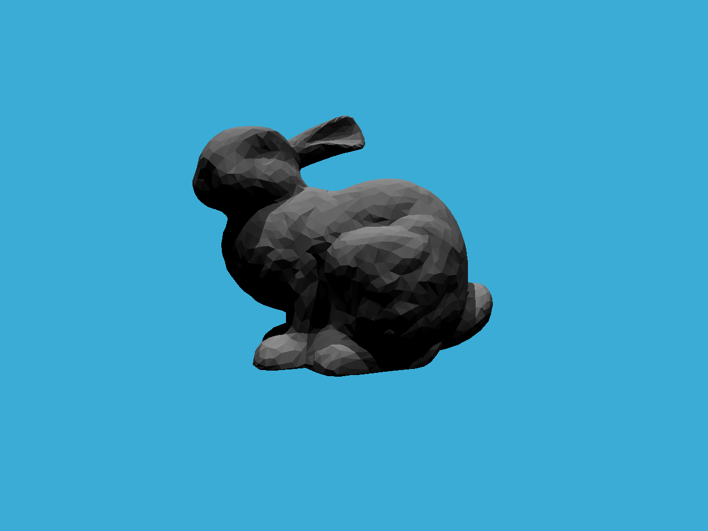

# GAMES101 作业 6：加速结构（BVH）

| 项目 | 信息 |
| --- | --- |
| 姓名 | 请填写姓名 |
| 学号 | 请填写学号 |
| 完成日期 | 请填写日期 |

## 1. 作业概述

本作业在光线追踪框架中完成三角形求交、轴对齐包围盒（AABB）求交和
BVH 遍历，使程序能够先用包围盒排除不可能命中的物体，再对候选图元进行
精确求交。与逐个测试场景中所有三角形相比，BVH 能显著减少求交次数。

本次完成的是作业要求的基础 BVH 功能。BVH 的构建沿用框架提供的
“质心包围盒最长轴 + 中位数划分”方法，未实现 SAH 加分项。

## 2. 完成情况

| 内容 | 位置 | 状态 |
| --- | --- | --- |
| 生成主光线并渲染图像 | `Assignment6_code/Renderer.cpp` 中的 `Renderer::Render` | 已完成 |
| Möller–Trumbore 三角形求交 | `Assignment6_code/Triangle.hpp` 中的 `Triangle::getIntersection` | 已完成 |
| 光线与 AABB 求交 | `Assignment6_code/Bounds3.hpp` 中的 `Bounds3::IntersectP` | 已完成 |
| BVH 递归遍历与最近交点选择 | `Assignment6_code/BVH.cpp` 中的 `BVHAccel::getIntersection` | 已完成 |
| SAH（Surface Area Heuristic）划分 | — | 未实现（加分项） |

## 3. 主要实现

### 3.1 `Renderer::Render`

对每个像素执行以下步骤：

1. 使用像素中心 `(i + 0.5, j + 0.5)` 采样，减少由采样落在像素边界造成的偏差；
2. 把像素坐标映射到以图像中心为原点的相机平面；
3. 使用宽高比和垂直视场角修正相机空间坐标，并翻转屏幕坐标的 Y 轴；
4. 构造指向 `(x, y, -1)` 的单位方向向量；
5. 从相机位置发射主光线，通过 `Scene::castRay` 计算颜色；
6. 将帧缓冲区写入二进制 PPM 文件 `binary.ppm`。

核心方向计算为：

```cpp
float x = (2 * (i + 0.5) / scene.width - 1) * imageAspectRatio * scale;
float y = (1 - 2 * (j + 0.5) / scene.height) * scale;
Vector3f dir = normalize(Vector3f(x, y, -1));
```

### 3.2 `Triangle::getIntersection`

使用 Möller–Trumbore 算法直接在参数空间中求解光线与三角形的交点：

```text
P(t) = O + tD
P    = (1 - u - v)V0 + uV1 + vV2
```

实现依次完成：

- 根据三角形法线剔除背面；
- 用行列式的绝对值判断光线是否与三角形平面近似平行；
- 检查重心坐标 `u >= 0`、`v >= 0`、`u + v <= 1`；
- 检查 `t > EPSILON`，排除相机后方交点及过近的自相交；
- 命中后填写 `Intersection` 的 `happened`、`coords`、`normal`、
  `distance`、`obj` 和 `m` 字段。

当前 `Triangle` 只保存一个面法线，没有保存三个顶点法线，因此这里使用面法线，
不进行法线插值。`u`、`v` 用于判断交点是否位于三角形内部；如果以后加入纹理坐标
或顶点法线，也可以用它们进行重心插值。

### 3.3 `Bounds3::IntersectP`

采用 slab method。AABB 可以看作 X、Y、Z 三组平行平面围成的区间；光线必须在
三个轴上拥有共同的有效参数区间，才算与包围盒相交。

实现从光线自身的 `[t_min, t_max]` 开始，逐轴更新：

```text
tEnter = max(tEnter, tNear)
tExit  = min(tExit,  tFar)
```

若任意时刻 `tEnter > tExit`，说明三个轴的区间没有交集，可以立即返回 `false`。
代码使用预计算的 `invDir` 避免重复除法，并通过 `dirIsPositive` 选择近、远平面。
当某一方向分量为零时，单独判断光线原点是否位于该轴的 slab 内，避免无穷大参与
后续计算带来的边界问题。

### 3.4 `BVHAccel::getIntersection`

BVH 遍历过程如下：

1. 空节点直接返回未命中；
2. 当前节点包围盒未命中时，剪掉整个子树；
3. 叶节点直接调用图元的 `getIntersection`；
4. 内部节点递归查询左右子树；
5. 只有一侧命中时返回该侧；两侧都命中时比较 `distance`，返回距离更近的交点。

这里 `Intersection::distance` 是选择最近可见交点的依据。若只比较
`happened` 而不比较距离，遍历结果会依赖左右子树的排列顺序。

## 4. 开发与运行环境

本地验证环境：

- Windows 11
- Visual Studio Code
- MSYS2 UCRT64
- GCC/G++ 16.2.0
- CMake 4.4.2
- Ninja 1.13.2
- C++17

所有编译器、构建工具和第三方库均来自同一套 UCRT64 环境，未混用
`C:/mingw64` 或 MSVC 工具链。

## 5. 构建与运行

### 5.1 Windows（本地已验证）

在 `Assignment6_code` 目录中执行：

```powershell
C:/msys64/ucrt64/bin/cmake.exe --preset ucrt-debug --fresh
C:/msys64/ucrt64/bin/cmake.exe --build --preset ucrt-debug
Set-Location build-ucrt
./RayTracing.exe
```

程序使用相对路径 `../models/bunny/bunny.obj`，因此运行时应位于
`build-ucrt` 目录。渲染完成后，`binary.ppm` 也会生成在该目录中。

### 5.2 Linux / 课程虚拟机

```bash
cd Assignment6_code
mkdir -p build
cd build
cmake ..
make -j
./RayTracing
```

当前版本已在 Windows UCRT64 环境完成验证；提交前建议在课程指定的虚拟机中再执行
一次干净构建和渲染。

## 6. 渲染结果

场景分辨率为 1280 × 960。本机 Debug 构建的一次完整渲染约为 2 秒；该时间仅用于
说明本次运行结果，会随硬件、编译模式和系统负载变化。



原始程序输出为 `build-ucrt/binary.ppm`；上图是由同一次输出转换得到的 PNG，便于在
README 和代码托管平台中预览。

## 7. 验证记录

本次完成后进行了以下检查：

- `ucrt-debug` 配置与构建成功；
- 完整运行 `RayTracing.exe`，进程正常结束并生成 1280 × 960 的 PPM 图像；
- 人工检查结果图，兔子模型、背景和阴影均正常显示；
- 对 BVH 遍历进行了 8 组定向测试：左右子树最近交点、仅右侧命中、双侧未命中、
  根包围盒剪枝、负方向光线、光线起点位于包围盒内部、叶节点包围盒剪枝和空节点；
- 8 组定向测试均通过。

原始框架没有提供 CTest 测试目标，因此上述定向测试属于本地辅助验证代码，不包含在
提交源码中。

## 8. 已知限制与可改进方向

- 未实现 SAH，当前 BVH 仍使用质心最长轴上的中位数划分；
- 三角形使用面法线，渲染结果为平面着色；若模型提供顶点法线，可用重心坐标插值；
- 当前遍历会同时查询左右子树，再比较最近交点。进一步优化时，可以优先访问更近的
  子节点，并用当前最近距离缩短后续光线区间；
- 可缓存每条光线的方向符号，避免在每个递归节点中重复计算；
- 可在实现 SAH 后记录 BVH 构建时间和渲染时间，与当前中位数划分进行对比。

更详细的学习与代码说明见：

- [作业要求与学习路线](Assignment6_作业要求与学习路线.md)
- [框架函数讲解](Assignment6_框架函数讲解.md)
- [BVH 遍历改进建议](Assignment6_BVH遍历改进建议.md)

摆烂太久了 都看不懂代码了 剪个枝写了半天 明天在写了 去打游戏了

