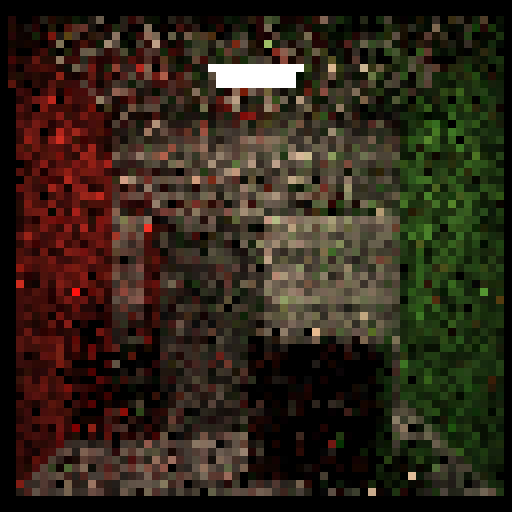
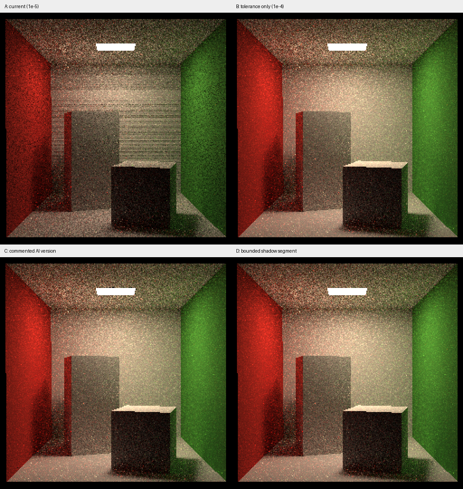

# Scene::castRay() 检查结果与优化建议

> 提交整理更新：当前正式代码已经采用第 13 节的有限长度阴影射线与数值检查。
> 本文保留修改前后的诊断过程，最终参数与结果见 [提交 README](Assignment7_code/README.md)。

本文件保留两轮检查。**最新的条纹诊断、AI 版本对比与具体修改方法在第 11～15 节。**
最新结论：已用相同随机样本复现横条纹，并确认过紧的阴影可见性容差是主因；
仅把 `1e-5` 改为 `1e-4` 就明显消除了该条纹，推荐进一步改为有限长度阴影射线。

初次检查日期：2026-11-05。第 1～10 节是修改前的历史记录，针对当时
[Scene.cpp](Assignment7_code/Scene.cpp) 第 67～148 行；其中部分问题现已修正。
第二轮复查同日进行，当前函数位于第 67～156 行，注释中的 AI 版本位于第 158～215 行。
后续继续修改后，行号可能变化，应以代码片段定位。

## 1. 结论：结构已齐全，但目前还不能判为正确完成

你已经实现了路径追踪的主要控制流程：未命中返回黑色、命中灯返回发光值、
直接光估计、RR、半球反弹、过滤间接撞灯和递归权重。

当前最需要修复的是**直接光的可见性条件**。此外，未检查真实命中与灯面正反方向
会产生负贡献；无效 PDF/距离缺乏保护，可能产生非有限值。

| 分类 | 结论 | 优先级 |
| --- | --- | --- |
| 直接光遮挡判断 | 条件方向不对，无遮挡时会拒绝正常灯命中 | 必须先修，P1 |
| 阴影命中有效性、余弦范围 | 未命中被当作通过，灯背面可以产生负值 | 必须修，P2 |
| PDF、距离与方向的有效性 | 缺少检查，有明确的无效 PDF 非有限值反例 | 应补齐，P2 |
| 次级光线起点 | 直接从交点发射，依赖 EPSILON 抵消自相交 | 数值稳定性改进，P2 |
| RR 和间接光主体 | 当前漫反射模型下的结构与权重基本符合要求 | 保留，修好直接光后继续验收 |
| 性能、重复计算与配置 | 有优化空间，暂不应先于正确性修改 | 后续优化 |

本次只增加检查文档、README 导航和评审小图，**没有替你修改算法源码**。

## 2. 最重要的问题：当前可见性判断拒绝了正常命中

位置：`Scene.cpp` 第 106～111 行。

```cpp
Ray light_ray(p, toLight);
Intersection shadow_inter = intersect(light_ray);
if (shadow_inter.distance - r > EPSILON)
```

`r` 是当前点到采样灯点的距离。阴影光线无遮挡时，通常会直接命中灯面，
此时 `shadow_inter.distance ≈ r`，差接近零，而不是大于一个正 EPSILON。

当前条件的实际效果：

| 情况 | 最近交点距离 | 当前判断 | 应有行为 |
| --- | --- | --- | --- |
| 有物体挡在灯前 | `< r` | 通常拒绝 | 拒绝，正确 |
| 正常到达灯点 | `≈ r` | 通常拒绝 | 应接受 |
| 根本没命中 | 默认极大值 | 接受 | 不能当作“命中了采样灯点” |

### 建议怎样改

先选择一种明确的可见性定义。以下两种方式可以选一种：

**方式一：射线应当命中采样灯点。**

要求真实命中，再比较命中距离与目标距离是否在容差内一致，或者比较命中坐标与采样点。
不要只是把 `>` 改成 `<`：那样可能把灯前的遮挡物也判成可见。应比较**距离差的绝对值**。

**方式二：只检查到灯前这一段有没有遮挡。**

在灯点前留一个小容差，设置阴影射线的 `t_max`，区间内无命中表示无遮挡。
你目前的包围盒与三角形求交已经包含射线区间逻辑，可以使用这种设计。

采用起点偏移后，要从偏移后的起点重新计算阴影方向和目标距离。
不要用偏移后射线的命中距离与原始 `r` 严格比较，也不要混用两种可见性定义。

### 已执行的确定性反例

建立一个漫反射三角形和朝向它的发光三角形，固定一个有效灯面样本：

```text
当前点 p = (0.25, 0.25, 0)
灯点   x = (0.25, 0.25, 2)
表面法线 = +Z，灯法线 = -Z
Le = (4,4,4)，Kd = (0.5,0.5,0.5)
r² = 4，pdfArea = 2，两个余弦都是 1
```

这个给定样本的直接光应为：

```text
4 × (0.5/π) / (4×2) ≈ 0.07957747（每个通道）
```

实际阴影光线成功命中，距离正好为 2，但原函数返回 `(0,0,0)`。
场景中没有可贡献额外间接光的其他非发光对象，所以不受 RR 随机结果影响。

这证明该问题是具体公式/条件错误，不是低 SPP 的随机噪声。

## 3. 未检查真实命中，且余弦没有限制到有效半球

位置：`Scene.cpp` 第 108～111 行。

直接光应只保留有效朝向：

```text
cosSurface = max(0, dot(n, toLight))
cosLight   = max(0, dot(n_light, -toLight))
```

当前没有对灯面余弦做限制。三角形求交会剔除背面；当采样到背向接收面的灯时，
阴影射线可能根本未命中灯，`distance` 保持极大值，却满足当前条件。
随后负的 `cosLight` 被乘入，得到负辐射亮度。

**实测反例：**将上一节发光三角形的法线翻为 +Z，其他数据不变。
阴影光线未命中，正确贡献应为 0，当前实际返回每通道约 `-0.07957747`。

这应在光照贡献计算时处理，而不是留到渲染器写图时裁剪。
写图的 `clamp()` 无法挽回负贡献与其他正贡献相加时已经造成的错误。

修复顺序：先验证样本和正向余弦，再做对应的可见性判断，最后套公式。
只要该样本无效或朝向不符，令本次直接光为零，仍可继续计算间接光。

## 4. 补齐数值保护，不要把无效样本带进除法

涉及位置：`Scene.cpp` 第 96～111 行、第 141～145 行。

### 4.1 面积 PDF 应先初始化并检查

当前是 `float pdfArea;`。正常的默认场景有发光网格，采样器会写入它；
但场景没有发光对象时，`sampleLight()` 没有保证输出被写入。

建议初始化为零，采样后确认：

- `pdfArea > 0` 且有限。
- `r² > 0` 且有限。
- 灯面法线和方向有效，两个余弦属于有效范围。

在本次专门提供 `pdfArea=0` 的无效样本测试中，原函数返回了 `(-inf,-inf,-inf)`。
这个测试有意注入无效 PDF，用于验证防护，不表示默认 Cornell Box 的采样器通常返回零。

### 4.2 零距离不能调用无保护的归一化

当前 `(x-p).normalized()` 和 `lightSample.normal.normalized()` 都直接除以向量长度。
框架的成员 `normalized()` 没有零长度检查。
应先确认向量有效，再归一化或参与计算。

不要仅通过把分母强行替换成 EPSILON 来“消除错误”；这可能把无效样本变成巨大的有偏贡献。

### 4.3 方向 PDF 也应在递归前检查

当前先找下一交点，再查询 `pdfDirection`，最后直接作为除数。
对当前非退化漫反射材质，大部分采样都有正 PDF，但半球边界或无效方向仍可能返回零。

建议在采样 `bounceDir` 后就查询 PDF，检查其有限且为正、余弦为正，再做下一次求交。
无效时直接保留 `l_dir`，既减少无用求交，也避免无效除法。

同样应确认没有产生 NaN/Inf 后再累加；不过有限值检查只是兜底，不能代替正确的公式和采样。

## 5. 次级光线建议避免从原交点原样出发

位置：阴影光线第 106 行，反弹光线第 128、145 行。

当前两种光线都从 `p` 出发。三角形中的 `t<=EPSILON` 排除能过滤理想的零距离命中，
但浮点交点不一定严格落在表面上，尤其是 Cornell Box 数百单位的坐标尺度。
重新求交时的误差可能大于固定阈值，导致错误自遮挡或非常近的重复命中。

建议沿表面朝外方向适量偏移起点，或采用一致的射线下界策略。
偏移量需要和场景尺度相容，不能大到穿过邻近几何。

必须保持：

- 阴影射线的起点、方向、目标距离使用同一套偏移后数据。
- 间接预检查和递归使用**同一条反弹光线**，不要一条偏移、一条仍从 `p` 出发。
- 直接光几何权重可继续使用原始表面点 `p` 与灯点 `x`，与可见性容差的职责区分清楚。

这一项是静态分析得到的数值风险；本次没有将小图中的具体黑点单独归因到自相交。

## 6. 哪些部分已经写对了

| 内容 | 当前评价 |
| --- | --- |
| 未命中返回黑色 | 符合当前无环境光的 Cornell Box 基础场景 |
| 命中发光材质直接返回发光值 | 能让相机直接看到灯，已通过测试 |
| 直接光公式的因子结构 | `Le × BRDF × 两个余弦 / (r²×面积PDF)` 的结构正确，需修可见性及边界 |
| RR 比较方向 | 随机数大于 0.8 时结束，否则继续，即约 80% 存活 |
| RR 失败保留直接光 | `return l_dir` 正确，没有把已算直接光丢掉 |
| 间接下一跳未命中时返回直接光 | 对当前无环境照明的设定合理 |
| 过滤间接路径命中灯 | 与显式光源采样配合，避免直接光重复计入；适用于当前纯漫反射基础版 |
| 间接权重 | 当前材质 BRDF、表面余弦、方向 PDF 和 RR 存活概率的位置基本正确 |
| 递归参数 | 传入反弹光线，且使用 `depth+1` |
| 线性累加 | 没有在反弹过程中做显示映射，也没有重复除 SPP |

`depth` 目前仅用于递归计数，没有固定上限；在当前固定存活概率小于 1 的 RR 策略下，
这本身不算遗漏。不要为了使用现有 `maxDepth=1` 字段而把正常间接反弹全部截断。
实际生产实现可以增加异常路径保护，但应说明固定截断带来的偏差。

“间接公式结构正确”不代表已经证明其多次反弹的统计结果正确；
本次没有做高 SPP 的能量/收敛检验，直接光和框架采样问题修好后仍需验收。

## 7. 接口与性能优化：按收益和改动大小排序

### 7.1 修正无效的归一化调用，统一材质方向输入

位置：第 85～87 行、第 104 行。

```cpp
Vector3f travelDir = ray.direction;
travelDir.normalized(); // 返回新向量，不会修改 travelDir
```

若确实要归一化，需要接收返回值，或在定义时调用 `normalize()`。
默认渲染器已提供单位相机方向，你生成的反弹方向也有归一化，
所以这行目前通常不改变画面，但不能将它理解为已经进行了就地修改。

`eval(viewDir, x-p, n)` 的第二参数也应使用已经得到的单位 `toLight`。
当前 Lambertian 分支只用它的符号判断，因此长度不会改变 BRDF；
换到依赖夹角的材质时，传非单位方向会出问题。

第一参数采用 `viewDir` 还是原来的传播方向，应由材质的方向约定统一决定。
目前漫反射分支忽略第一参数，本次不将你的 `viewDir` 单独判为当前亮度错误。

### 7.2 RR 使用场景已有配置，注释写成“存活概率”

局部 `P_RR=0.8` 与 `Scene::RussianRoulette=0.8` 重复。
当前数值一致，尚未因此改变结果；但之后修改场景成员不会影响这个函数。
建议只保留一个配置来源，并保证它在有效范围内。

第 70 行写“光线消失概率”，实际代码表示的是继续追踪的存活概率，建议改清楚。

### 7.3 复用反弹光线，随后再考虑复用交点

当前顺序为：

```text
构造 Ray(p,bounceDir) → 求 nextSample
构造同样的 Ray      → castRay 内部重新求交
```

最小整理是先创建一个反弹光线变量，让预检查与递归复用。
它也能减少以后加起点偏移时两个地方不一致的风险。

进一步优化可以增加内部辅助函数接收已知交点，省掉第二次相同求交。
但会调整函数结构，应在正确性稳定后再做，不建议现在为了省一次查询重写整个流程。

### 7.4 缓存几何中间量

`x-p` 目前用于归一化、距离和材质查询，被重复计算。
可保存 `delta`、`r²=dot(delta,delta)`、`r=sqrt(r²)`、`toLight=delta/r`。
这样能减少重复构造和平方根，也让零距离检查更集中。

### 7.5 随机数生成器属于框架层的潜在开销

`global.hpp::get_random_float()` 每次调用都创建 `random_device`、播种 `mt19937`。
路径追踪会频繁调用它，后续可改成每个线程持有一个持续使用的生成器。
如需可重复对比，可以再加入明确的测试种子控制。

这项本次没有性能基准；不能承诺具体加速倍数。
不要先加入多线程掩盖当前错误，也不要在并行情况下让多个线程无保护地共享可变生成器。

## 8. 框架已有问题：与这次 castRay 的错误分开处理

### 8.1 网格面积采样分布与 PDF 不匹配

`BVH.cpp` 第 169 行仍然是 `sqrt(random)*root->area`。
在累计面积区间里这样取参数，并不等于按面积均匀选择三角形，但函数返回的是均匀面积 PDF。
这也影响默认网格灯；修好 `castRay()` 的可见性并不能自动修好该采样偏差。

### 8.2 多光源时缺少对象选择概率

`Scene::sampleLight()` 按面积选择发光对象后，直接返回对象内部的条件 PDF，
没有合并选择该对象的概率。默认只有一个发光网格，这一层的选择概率为 1；
扩展多光源时需要核对全局 PDF。

不要在 `castRay()` 中乘一个经验系数来补偿这些框架问题。
它们与可见性错误是不同原因，应分别修改、分别验证。

## 9. 本次实际验证了什么

### 9.1 构建与环境

- 原工程 UCRT64 Debug 增量构建通过。
- `ctest --preset ucrt-debug`：环境检查 1/1 通过。
- 本次读取确认：包围盒已改为 `return true`，三角形包含 `t_min/t_max` 检查。

环境检查不执行光照算法，因此它的通过不能作为 `castRay()` 正确的证据。

### 9.2 针对原函数的简化场景测试

测试程序直接编译当前 `Scene.cpp/BVH.cpp/Vector.cpp`，未改 `castRay()`。
灯面采样使用固定样本的测试替身，隔离本次着色计算；它不用于证明原始面积采样器的统计分布。

| 测试 | 期望 RGB（每通道） | 实际 RGB（每通道） | 结果 |
| --- | --- | --- | --- |
| 未命中场景 | 0 | 0 | 通过 |
| 相机直接看到灯 | 4 | 4 | 通过 |
| 无遮挡、朝向正确的固定灯样本 | 约 0.07957747 | 0 | 失败：可见性条件 |
| 灯背面朝向接收面 | 0 | 约 -0.07957747 | 失败：未命中及半球处理 |
| 注入零面积 PDF | 忽略无效样本，返回有限值 | `-inf` | 失败：缺少 PDF 防护 |

最后一项是刻意构造的无效输入；前三类有效几何场景则用于检查正常行为。
测试源代码和输出保存在本地 `Assignment7_code/build-ucrt/review-castray/`，
属于被 Git 忽略的临时验证产物，清理构建目录后可以删除。

### 9.3 Cornell Box 小图：能运行，但不代表公式正确

使用原始 `Scene.cpp`，仅在临时入口和渲染器副本中将参数降为 **64×64、8 SPP**，
以 `-O2` 编译后运行成功，并已查看结果。原来的 `main.cpp/Renderer.cpp` 参数未修改。

下图是原始 64×64 结果的最近邻放大，方便阅读；不是 512×512 的真实渲染，
也不满足正式作业的分辨率要求：



图中可辨认光源、盒子和墙面颜色，但固定样本反例已经证实直接光计算有错误。
实际场景的距离计算存在浮点误差，可能让一部分本不应依靠误差通过的样本满足当前条件；
这是“仍然能够成图”的一种原因，不能据此认定可见性判据正确。

本次没有生成正式 784×784、16 SPP 结果，也没有验证课程虚拟机、
高采样数收敛、无偏性或所有数值退化情况。小图运行耗时不足以预测最终渲染时长。

## 10. 建议你下一轮按这个顺序修改

1. 修正灯点可见性，明确选择“命中灯点”或“有限区间无遮挡”其中一种定义。
2. 初始化面积 PDF，增加距离、PDF、有效方向与正向余弦检查。
3. 统一阴影和反弹光线的起点偏移；预检查和递归复用同一条射线。
4. 修正无效归一化调用，让材质查询使用单位方向，统一 RR 配置。
5. 先重测两个关键有效输入：无遮挡灯样本应为正值，背向灯不产生负值。
6. 再检查实际小图、框架采样分布和高 SPP 趋势。
7. 最后考虑消除重复求交、随机数开销和多线程，并生成正式提交图。

你不需要推翻现在的结构。优先把直接光的判据与数值边界修好，现有间接光流程可以作为继续完善的基础。

## 11. 第二轮复查：横条纹的原因已经复现

### 11.1 你已经修正了哪些内容

本轮读取当前源码，确认这些修改已经生效：

- `pdfArea` 初始化为零。
- `travelDir` 正确接收归一化结果。
- 直接光的两个余弦都用了 `max(0, ...)`。
- RR 使用场景的 `RussianRoulette`。
- 间接预检查与递归复用了同一个 `nextRay`。
- 灯点距离判断从 `> EPSILON` 改成了 `> -EPSILON`。

最后一项修正了先前“正常命中直接被拒绝”的方向问题，但**当前容差仍然过紧**。
所以第 2 节的旧反例不能直接代表现在的代码，当前问题需要看下面的新对照。

### 11.2 这次看到的是什么条纹

已经查看 `build-ucrt-release/` 下的三张 784×784 PPM：
`binary.ppm`、`直接光渲染(无间接光).ppm`、`直接光渲染(无间接光 32次采样).ppm`。
其中当前 `binary.ppm` 的背墙有明显水平亮暗条纹。文件名中的采样数只作为你的文件标签，
PPM 本身不记录 SPP，本次没有据此推定每张旧图一定由哪一版函数生成。

为了避免旧图、旧程序和随机采样差异影响判断，本次另外生成了下面的受控对照。

### 11.3 为什么 `1e-5` 会把无遮挡的灯点判成遮挡

当前 `Renderer.cpp` 定义：

```cpp
const float EPSILON = 0.00001; // 1e-5
```

你的第 107 行判断是：

```cpp
if (shadow_inter.distance - r > -EPSILON)
```

对于正常到达灯面的光线，理想值是 `shadow_inter.distance == r`。
实际两者来自不同计算路径：

- `r` 来自采样点坐标与 `p` 相减后求长度，使用 `float`。
- 命中距离来自三角形求交；尽管最后存入 `double`，顶点、向量、叉乘和点乘仍大量使用 `float`。
- 采样点自身通过浮点重心权重生成，也未必严格落在理想平面上。

这些舍入误差会让实际差值略正或略负。坐标约为 500 时，`float` 相邻可表示值的间隔是：

```text
3.0517578125e-5
```

这个间隔已经约为 `1e-5` 的三倍。它不是完整误差上界，但足以说明当前阈值比相关数据的
基本精度尺度还紧。将接近零、略小于 `-1e-5` 的误差当成真实遮挡，就会错误删除直接光。
只把某个局部变量改为 `double` 不能消除已经发生在 `Vector3f` 运算中的舍入。

### 11.4 为什么误差看起来是横条纹，而不是随机噪点

相邻像素行看的是同一个平面，主光线方向和交点坐标按行规律变化。
相近的几何计算可能产生相关的舍入误差，于是某些行更容易跨过过紧的判定阈值，
成片丢失一部分直接光，形成水平亮暗带。

灯面采样虽然随机，但这个误判概率受像素位置影响。
增加 SPP 会让错误的平均结果更稳定，不能修正可见性判据本身。

因此，这类表面条纹应优先按**浮点可见性伪影**处理。
轮廓边缘的像素锯齿和低 SPP 的随机颗粒，是另外两类问题，见第 15 节。

## 12. AI 版本为什么看起来没有同样的条纹

本轮对比的是 `Scene.cpp` 末尾实际保留的注释版本，而不是根据描述猜测另一份代码。

| 差异 | 你的当前代码 | 注释中的 AI 代码 | 对当前条纹的作用 |
| --- | --- | --- | --- |
| 灯点距离容差 | `> -EPSILON`，即约 `-1e-5` | `> -1e-4` | 关键差异：AI 容差宽约 10 倍 |
| 材质第二个方向 | `x-p` | 单位 `ws` | 目前漫反射只检查方向符号，不是条纹主因；仍建议用单位方向 |
| 材质第一个方向 | `viewDir` | `ray.direction` | 当前 DIFFUSE 分支忽略该参数，不是条纹主因 |
| 间接方向 PDF 检查 | 没有正值保护 | `pdf_hemi > 1e-6` | AI 在这点有额外防护，不是已复现的横条纹主因 |
| RR 随机数使用 | 大于概率时返回 | 小于概率时递归 | 存活概率基本一致，随机轨迹不同，不解释稳定横条纹 |
| 射线起点偏移 | 没有 | 实际也没有 | AI 注释提到偏移，但代码仍是 `Ray(p, ws)`，不能据注释认定已实现 |

### 12.1 四组实际渲染对照

使用同一场景、相机、256×256、32 SPP、`-O2`，在临时副本中渲染：

| 标记 | 版本 | 结果 |
| --- | --- | --- |
| A | 你当前的函数，阈值 `1e-5` | 复现明显水平条纹 |
| B | 仅将 A 的阈值改为 `1e-4` | 相同采样下，明显条纹消失 |
| C | 实际注释中的 AI 函数 | 没有出现 A 的相同条纹，仍有正常采样噪声 |
| D | 你的结构，改为有限长度阴影射线，并补起点偏移和数值检查 | 没有出现 A 的相同条纹，仍有正常采样噪声 |

对照为可重复测试，在临时头文件中使用固定种子的持续随机数生成器，按像素重置种子。
**A 与 B 的唯一着色差别是这一处容差，随机路径和样本一致**，因此能把条纹变化定位到该判据。
C 使用不同的 RR 分支，D 改变了射线起点，所以它们不能与 A/B 做逐像素一致性判断。
这不是随机数性能优化实验，也没有修改正式 `global.hpp`。

下图依次为左上 A、右上 B、左下 C、右下 D；原始渲染均为 256×256，最近邻放大方便观察：



四组都完成运行，所检查的路径样本未记录到 NaN/Inf；这不等于已覆盖所有无效输入。
图像对照证明的是当前场景的条纹主因和修复效果，不证明 AI 版本或候选版对任意场景都正确。

### 12.2 补充距离误差计数

另外扫描背墙样本，把真实命中距离位于目标灯点 `1e-3` 邻域的样本单独统计：

```text
该邻域内样本数：386237
使用 1e-5 条件被拒绝：136404，约 35.3%
使用 1e-4 条件被拒绝： 22453，约  5.8%
```

这是对“端点附近的实际命中”的距离判定统计，不是对所有场景光线的可见性真值评测。
它说明当前阈值会排除大量端点附近样本，也说明单纯改到 `1e-4` 并非严格解决全部情况。

**AI 代码这次表现更好，主要是它的容差碰巧更适合当前尺度。**
它仍保留“没有命中时极大 distance 也通过”的单侧判据，也仍缺少真实起点偏移。
不能据这张图就认定那份实现更完整或无偏。

## 13. 具体修改方法：先验证原因，再替换阴影射线逻辑

下面给出局部修改，不要求你重写整个函数。本轮仅将它们用于构建目录中的评审副本，
正式源码仍由你修改。

### 13.1 第一步：一行修改，用来验证条纹来源

将当前第 107 行暂时改为：

```cpp
if (shadow_inter.distance - r > -1e-4f)
```

这是最小诊断改动，对应对照 B。重新构建并保持分辨率/SPP 不变，应该看到横条纹明显改善。
它不是最终推荐的通用可见性判断，不要到这里就停止。

**不要直接把全局 `EPSILON` 改成 `1e-4`。** 它还用于三角形行列式、近距离命中等判断；
你现在要调的是阴影端点容差，不应该顺带改变其他算法的数值语义。

### 13.2 第二步：推荐用“灯点前的线段内没有遮挡”

这个定义不要求阴影光线恰好返回灯点：只检查起点到灯点前一小段距离。
你的三角形、包围盒求交都已有 `t_min/t_max` 检查，能够支持它。

把当前从 `Intersection lightSample;` 到直接光计算结束的部分，约第 91～116 行，
替换成下面这个局部结构。外层的 `p/n/viewDir/material/l_dir` 沿用你现有变量：

```cpp
// 当前 Cornell Box 的起始参数；不是任意场景都通用的常量。
const float rayOriginBias = 1e-4f;

Intersection lightSample;
float pdfArea = 0.0f;
sampleLight(lightSample, pdfArea);

Vector3f delta = lightSample.coords - p;
float r2 = dotProduct(delta, delta);

if (pdfArea > 0.0f && std::isfinite(pdfArea) &&
    r2 > rayOriginBias * rayOriginBias && std::isfinite(r2))
{
    float r = std::sqrt(r2);
    Vector3f toLight = delta / r;
    Vector3f lightNormal = normalize(lightSample.normal);
    float cosSurface = std::max(0.0f, dotProduct(n, toLight));
    float cosLight = std::max(0.0f, dotProduct(lightNormal, -toLight));

    if (cosSurface > 0.0f && cosLight > 0.0f)
    {
        // 偏移后重新计算到同一灯点的方向和距离。
        Vector3f shadowOrigin = p + n * rayOriginBias;
        Vector3f shadowDelta = lightSample.coords - shadowOrigin;
        float shadowDistance = shadowDelta.norm();
        float endpointTolerance =
            std::max(1e-4f, 1e-6f * shadowDistance);

        if (std::isfinite(shadowDistance) &&
            shadowDistance > endpointTolerance)
        {
            Ray shadowRay(shadowOrigin, shadowDelta / shadowDistance);
            shadowRay.t_max =
                static_cast<double>(shadowDistance) - endpointTolerance;

            // 区间内无交点才是无遮挡；不再要求区间内命中灯。
            if (!intersect(shadowRay).happened)
            {
                Vector3f fr = material->eval(viewDir, toLight, n);
                l_dir = lightSample.emit * fr * cosSurface * cosLight /
                        (r2 * pdfArea);
            }
        }
    }
}
```

注意这些配套关系：

1. `rayOriginBias` 定义在函数体这一层，后面的反弹光线也需要用到它，不能放进内层 `if`。
2. 起点偏移后，`shadowDelta/shadowDistance` 必须重新计算，否则射线终点会不一致。
3. `shadowRay` 方向是单位向量，`t_max` 才对应几何距离。
4. 灯点从查询区间中排除了，所以这里是 `!happened` 表示可见，不是要求命中灯。
5. 光照权重仍用原始 `p` 到灯点的 `r2/toLight`，偏移主要服务数值稳定性。
6. 容差越大越可能漏掉极靠近端点的薄遮挡，不能无限调大；这里参数在当前 Cornell Box
   尺度下作起点，换尺度或加入很薄的几何体后需要重新验收。

D 组测试使用的是这套有限区间结构，加上后面的反弹射线偏移和方向 PDF 检查。
示例是局部实现方法，不是已经自动写入你的正式源码。

### 13.3 第三步：反弹射线也采用一致的起点，并先检查方向 PDF

当前约第 129～132 行是：

```cpp
Vector3f bounceDir = material->sample(viewDir, n).normalized();
Ray nextRay(p, bounceDir);
Intersection nextSample = this->bvh->Intersect(nextRay);
```

建议改成：

```cpp
Vector3f bounceDir = normalize(material->sample(viewDir, n));
float pdfDirection = material->pdf(viewDir, bounceDir, n);
float cosBounce = std::max(0.0f, dotProduct(n, bounceDir));

if (!(pdfDirection > 0.0f) || !std::isfinite(pdfDirection) ||
    !(cosBounce > 0.0f))
{
    return l_dir;
}

Ray nextRay(p + n * rayOriginBias, bounceDir);
Intersection nextSample = intersect(nextRay);
```

相应地：

- 删除后面原有的 `float pdfDirection = ...`，避免重复声明。
- 保留“未命中”和“命中发光面”时返回 `l_dir` 的两段判断。
- 递归仍然传 `nextRay`，保持预检查和递归使用同一条偏移后的光线。
- 最后间接贡献使用已经计算好的 `cosBounce`：

```cpp
l_indir = castRay(nextRay, depth + 1) *
          material->eval(viewDir, bounceDir, n) * cosBounce /
          (pdfDirection * RussianRoulette);
```

当前 RR 控制流程可以保留。这些改进补齐数值边界；**本次横条纹的主要因果证据来自
A/B 容差单变量对照，不是把所有条纹都笼统归因于自相交。**

本轮还将第 13.2、13.3 节的代码块直接提取到临时副本，按说明去掉重复的 PDF 声明、
替换间接余弦后，重新编译并渲染 256×256、32 SPP。程序运行通过，未记录非有限样本，
查看结果也没有原来的明显横条纹。这验证了文档片段能按所述方式接入当前函数，
不表示已经替你修改正式代码或完成所有场景的正确性验证。

### 13.4 如果暂时保留“命中灯点”的设计

也可以继续用最近交点的方式，但至少同时满足：

```cpp
float shadowTolerance = std::max(1e-4f, 1e-6f * targetDistance);
bool visible = shadowHit.happened &&
               std::abs(shadowHit.distance - targetDistance) <= shadowTolerance;
```

这里 `targetDistance` 必须从实际阴影起点计算。
这是一种替代设计，不要和前面排除灯点的有限区间方案混用。
本轮图 D 验证的是有限区间方案；没有另外把这条替代设计作为单独渲染组测试。

## 14. 修改后怎样验证，避免旧程序或随机差异干扰判断

1. 先另存当前 PPM，避免下次运行覆盖有问题的证据图。
2. 完成改动后重新构建你实际运行的模式，不要只构建 Debug 却运行旧的 Release exe。
3. 先用小图检查背墙和墙角；需要观察细条纹时提高分辨率，保持相同 SPP。
4. 对比时保持相机、材质、模型和编译模式一致；不要同时换采样器、加多线程、改曝光。
5. 分别看“规则条纹是否消失”和“随机噪声是否下降”，不要混成一个指标。
6. 容差修好后再逐步提高 SPP，正式图仍需满足作业的分辨率和采样要求。

从 `GAMES101_Homework/` 开始，可用：

```powershell
Set-Location ./Assignment7/Assignment7_code
$env:PATH = 'C:/msys64/ucrt64/bin;' + $env:PATH
& 'C:/msys64/ucrt64/bin/cmake.exe' --preset ucrt-release
& 'C:/msys64/ucrt64/bin/cmake.exe' --build --preset ucrt-release
& 'C:/msys64/ucrt64/bin/ctest.exe' --preset ucrt-release

# 构建成功、旧图已另存后，再进入正确工作目录运行。
Push-Location ./build-ucrt-release
try {
    & ./RayTracing.exe
} finally {
    Pop-Location
}
```

CTest 仍只验证环境；渲染图要另行检查。本轮受控对照使用了临时 256×256 测试入口，
没有修改你正式 `main.cpp` 的 784×784 或 `Renderer.cpp` 的 16 SPP。

## 15. 最后区分三类图像问题与验证边界

| 图像问题 | 典型表现 | 本次处理方式 |
| --- | --- | --- |
| 浮点可见性伪影 | 平面内部规则横向明暗带 | 已通过 A/B 复现；修阴影端点容差与射线区间 |
| Monte Carlo 噪声 | 随机颗粒，低 SPP 明显 | 公式/采样正确后增加 SPP；不会靠阴影容差消除全部颗粒 |
| 像素空间走样 | 几何轮廓边缘阶梯状锯齿 | 需要像素内抖动/抗锯齿采样，是后续独立任务 |

当前渲染器的 16 次相机采样都使用同一个像素中心。
如果以后专门处理轮廓锯齿，应在每次 SPP 内重新生成像素内位置，再构造相机方向；
仅重复同一中心光线，不等于已经实现像素抗锯齿。
本轮 A/B 没有改相机采样，却能消除主要横条纹，因此无需先重写相机采样来解决这次问题。

框架中已有的 BVH 面积采样偏差和多光源 PDF 问题依然存在，见第 8 节。
它们在 A/B 中保持不变，不是本轮“只改容差条纹就消失”的解释，仍会影响后续严格正确性验收。

本轮正式源码与现有 PPM 均保留原样。实验代码、固定种子副本与日志在被忽略的
`Assignment7_code/build-ucrt/review-stripes/` 中；文档中的对照图另存于 `review_assets/`。
没有宣称候选方案已在任意尺度、薄几何、课程虚拟机或所有退化输入下验证通过。
