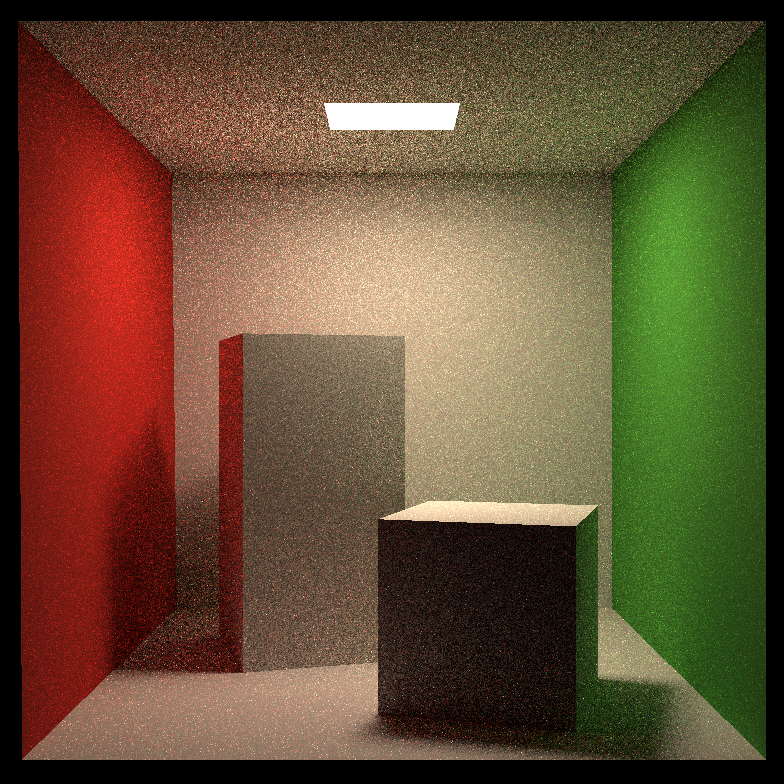

# GAMES101 Homework 7：路径追踪

基于课程提供的框架，实现 Cornell Box 场景的 CPU 漫反射路径追踪。
本次提交包含源码、模型、CMake 配置和 `images/` 中的结果图片。

## 完成内容

| 项目 | 完成情况 | 实现位置 |
| --- | --- | --- |
| 光线与三角形求交 | 已迁移，填写交点、法线、距离及材质，并检查射线区间 | `Triangle.hpp`：`Triangle::getIntersection()` |
| 光线与包围盒求交 | 已迁移，处理平行轴、相切和有效参数区间 | `Bounds3.hpp`：`Bounds3::IntersectP()` |
| BVH 遍历 | 已迁移，包围盒剪枝并返回最近有效交点 | `BVH.cpp`：`BVHAccel::getIntersection()` |
| 基础 Path Tracing | 已实现直接光、间接反弹、可见光源、Russian Roulette | `Scene.cpp`：`Scene::castRay()` |
| 数值处理 | 阴影射线使用起点偏移、有限区间和端点容差；检查距离与 PDF | `Scene.cpp`：直接光和反弹射线部分 |
| 多线程（加分项） | 未实现；渲染循环为单线程 | — |
| Microfacet（加分项） | 未实现；当前使用 DIFFUSE 材质 | — |

本说明列出实现和本地验证情况，不将其等同于课程评分结果。

## 结果与参数

主验收图为 **784×784、16 SPP**，满足原作业至少 512×512、8 SPP 的参数要求。
光源可直接看见，图中可观察到软阴影和红绿墙产生的间接颜色传递。



| 图片 | 分辨率 | 每像素采样 | 计算时间 | 说明 |
| --- | --- | --- | --- | --- |
| [主图 PNG](images/cornell_box_784x784_16spp.png) / [原始 PPM](images/cornell_box_784x784_16spp.ppm) | 784×784 | 16 | **59 秒** | 采样数和耗时由作者在整理提交时提供 |
| [补充对比 PNG](images/cornell_box_784x784_32spp.png) / [原始 PPM](images/cornell_box_784x784_32spp.ppm) | 784×784 | 32 | 未记录 | 采样数依据原保存文件名；用于观察增加 SPP 后的噪声变化 |

两张 PNG 均由对应原始 PPM 直接转换，没有进行去噪或修图。
硬件：Intel Core i5-14600K；本地开发使用 Windows 11、MSYS2 UCRT64。
59 秒为作者提供的历史渲染记录，本次未通过重新运行独立复测该时间。
详细文件信息及 PPM SHA-256 见 [images/results.json](images/results.json)。

**提交图参数与源码默认值有区别：**当前 `main.cpp` 为 784×784，
`Renderer.cpp` 中 `spp=128`。重新运行会生成 128 SPP 的新图，不能把它的参数或耗时
套用到上面的历史结果。复现 16 SPP 主图时，将 `spp` 设为 16 后重新构建。
随机数未固定种子，重复运行不会逐像素一致。

## 算法说明

`castRay()` 首先求最近交点，未命中返回黑色，命中发光材质返回发光值。
普通表面的贡献分为：

- **直接光：**在灯面取样，计算 BRDF、表面与光源余弦、距离平方和面积 PDF 权重。
  阴影射线从偏移后的起点出发，`t_max` 位于采样灯点之前；区间内无命中才认为无遮挡。
- **间接光：**使用材质提供的均匀半球采样，查询对应方向 PDF；
  RR 存活概率为 `0.8`，仅对命中非发光表面的路径递归，并除以方向 PDF 和存活概率。
  过滤间接采样撞灯，与显式光源采样配合，避免直接光重复计入。

颜色以线性 RGB 累加，像素平均和显示映射由 `Renderer::Render()` 负责。
此前背墙条纹主要来自过紧的灯点距离容差；当前改为有限长度阴影射线，并使用
`rayOriginBias=1e-4` 与随距离调整的端点容差。

## 编译与运行

工程依赖 C++17 编译器和 CMake，不需要 OpenCV、Eigen 或 GPU SDK。
所有命令从本 README 所在目录，即包含 `CMakeLists.txt` 的目录执行。

### 课程 Ubuntu / Linux

```bash
cmake -S . -B build-linux -DCMAKE_BUILD_TYPE=Release
cmake --build build-linux -j2
ctest --test-dir build-linux --output-on-failure
cd build-linux
./RayTracing
```

源码工程最低 CMake 版本为 3.10。上述 Linux 命令是复现入口，
**本次尚未在课程虚拟机中执行验证**。

### Windows / MSYS2 UCRT64

以下命令在 PowerShell 中运行；预设要求 CMake 3.21 或更新版本，
工具链默认安装在 `C:/msys64/ucrt64`：

```powershell
$env:PATH = 'C:/msys64/ucrt64/bin;' + $env:PATH
& 'C:/msys64/ucrt64/bin/cmake.exe' --preset ucrt-release
& 'C:/msys64/ucrt64/bin/cmake.exe' --build --preset ucrt-release
& 'C:/msys64/ucrt64/bin/ctest.exe' --preset ucrt-release

Push-Location ./build-ucrt-release
try {
    & ./RayTracing.exe
} finally {
    Pop-Location
}
```

Debug 使用同名预设 `ucrt-debug`，输出目录为 `build-ucrt/`。
VS Code 本地开发可在仓库根目录使用已有的 Assignment7 任务；提交包独立编译不依赖它们。

**运行时工作目录必须是源码目录下一层的构建目录。** 模型使用
`../models/cornellbox/*.obj` 相对路径。默认输出为当前工作目录的 `binary.ppm`，
重复渲染会覆盖它，重要结果应另存到 `images/`。
PPM 是 P6 二进制图片，转换成 PNG 时不要仅修改扩展名。

## 可调整参数

| 参数 | 位置 | 当前源码值 |
| --- | --- | --- |
| 宽高 | `main.cpp`：`Scene scene(...)` | 784×784 |
| SPP | `Renderer.cpp`：`int spp` | 128 |
| 视角 | `Scene.hpp`：`fov` | 40 度 |
| RR 存活概率 | `Scene.hpp`：`RussianRoulette` | 0.8 |
| 相机位置 | `Renderer.cpp`：`eye_pos` | `(278,273,-800)` |

修改参数后需要重新编译；没有 `--spp` 或分辨率命令行选项。
低分辨率、低 SPP 可用于调试；正式图片应保留符合要求的参数。

## 验证记录与适用边界

2026-11-05 在本地以 UCRT64 GCC 16.2.0、CMake 4.4.2、Ninja 构建：

- 当前源码在独立 Release 构建目录中完成干净配置、编译和链接。
- CTest 环境检查 1/1 通过，验证模型加载及 BVH 构建。
- 干净提交包解压后，已在副本中重新完成 Release 配置、构建和环境检查（1/1）。
- 上述提交图片尺寸已读取核验并进行了视觉检查，主要表面未见此前明显的规则横条纹。
- `--check-environment` 仅验证启动、模型与 BVH，不计算光照，不证明算法或图片完整正确。
- 课程 Ubuntu 虚拟机兼容性、高 SPP 无偏收敛和任意场景数值鲁棒性尚未独立验证。

默认场景只有一个发光网格，采样接口沿用课程框架。框架的
`BVHAccel::Sample()` 使用 `sqrt(random)` 选累计面积区间，与返回的均匀面积 PDF
存在不一致；多光源的对象选择概率也未合并到全局 PDF。这些已知采样边界未在本次
提交整理中改动，不能据此声称当前实现是任意场景下严格无偏的渲染器。

## 文件组织

```text
Homework7/
├── CMakeLists.txt
├── CMakePresets.json
├── README.md
├── *.cpp / *.hpp
├── models/
│   ├── cornellbox/
│   └── bunny/
└── images/
    ├── cornell_box_784x784_16spp.png / .ppm
    ├── cornell_box_784x784_32spp.png / .ppm
    └── results.json
```

提交包保留所有所需源码、模型、工程配置和结果图，排除构建目录、可执行文件、
缓存、课程 PDF、原始下载包及调试对照图。
原始框架及模型的权利归课程团队和各自作者所有，本项目用于个人课程学习。
